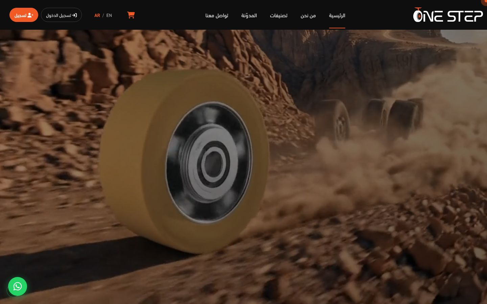
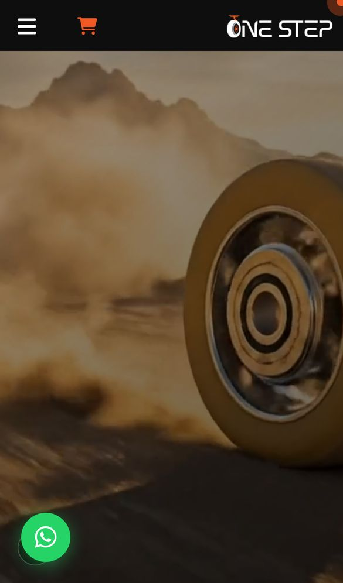
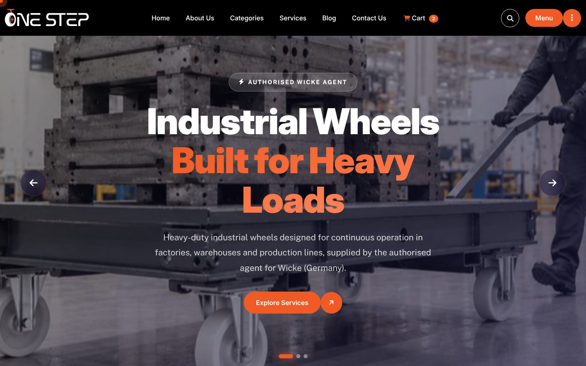

<div align="center">

# OneStep — Industrial Wheels & Casters

**Multi-page corporate + product-catalog front end for an industrial wheels & casters supplier.**
Production client work: the UI behind [onestepcorp.com](https://onestepcorp.com/).


[](https://onestepcorp.com/)

[**Live Site**](https://onestepcorp.com/) · [**Portfolio**](https://new-portfolio-ashy-xi.vercel.app) · [**LinkedIn**](https://www.linkedin.com/in/eslamraafat-dev/)

</div>

---

## Screenshots

<p align="center">
  
  &nbsp;
  
</p>
<p align="center"><sub>Live production site (onestepcorp.com) — desktop 1440×900 and iPhone 13, captured with Playwright.</sub></p>

<details>
<summary>Static build from this repository (served locally)</summary>
<br>

<p><sub>This repo's <code>index.html</code> at 1440×900: OneStep logo, imagery and English copy translated from the live Arabic site.</sub></p>
</details>

## Overview

| | |
|---|---|
| **Client** | OneStep — supplier of industrial wheels, casters and mobility solutions for factories and warehouses |
| **Type** | Corporate website + product catalog with cart |
| **My role** | Front-end implementation: page templates, responsive layout, catalog filtering UI, cart UI and interactions |
| **Production** | Live at [onestepcorp.com](https://onestepcorp.com/), served by a Laravel back end; Arabic-first (`lang="ar" dir="rtl"`) with an EN switch |

> **Repo vs. live:** this repository is the **static HTML/CSS/JS front end** (English, LTR). The live site is a later build of this UI wired to a Laravel back end (accounts, AJAX cart, AR/EN content) by the back-end developer.
>
> **Content:** brand, logo, contact details, product categories, products, FAQ, testimonials and blog copy come from the live site (Arabic copy translated to English); photos and client logos are the ones published on onestepcorp.com. Cart prices are demo values for the cart UI only, because the live catalogue shows no prices.

## Pages

14 HTML pages:

| Page | Purpose |
|---|---|
| `index.html` | Home — full-width fade hero slider (Swiper: autoplay, arrows, pagination), services, projects, testimonials, news |
| `about.html` | Company profile |
| `category.html` | The industry sectors (manufacturing, logistics, material handling, healthcare, food & beverage, hospitality) with a **filter bar** (housing type and material, load capacity, diameter, wheel tread, mounting type) |
| `category-details.html` | Manufacturing & Industry category with its four sub-categories (blue / grey elastic rubber, polyamide, polyurethane) |
| `product-details.html` | Polyamide wheel 200 mm / 1500 kg: thumbnail gallery, specs and related casters |
| `cart.html` | Shopping cart with live quantity / totals logic |
| `our-services.html` | Services overview |
| `service.html` | Services listing |
| `service-details.html` | Single service page |
| `news-grid.html` | Blog / news grid |
| `news-details.html` | Article ("Choosing the right industrial wheel for heavy-duty environments") with comment form |
| `faq.html` | FAQ accordion |
| `contact.html` | Riyadh and Cairo offices, map and a client-side validated message form (opens a pre-filled email; no server handler in this repo) |
| `404.html` | Custom error page |

## Key Features

### Product catalog & shopping UI
- **Domain-specific filter panel** (`assets/js/filter.js`, vanilla JS): dropdown filters and **dual-handle range sliders** for *Load Capacity* (80–8,000 kg) and *Diameter* (75–400 mm), the ranges used by the live catalogue, draggable with mouse **and** touch, synced to number inputs.
- **Mobile off-canvas filter drawer** with overlay, body-scroll lock, accordion sections and a "clear all" reset.
- **Cart logic** (vanilla JS, `cart.html`): +/- quantity controls, animated item removal, per-line totals, subtotal + 10% tax + grand total, live header badge count, and an empty-cart state that disables checkout. The prices are demo values for the UI, labelled as such on the page.
- Product gallery with active-thumbnail switching.

### Responsive UI
- Bootstrap 5 grid plus **445 `@media` rules** in the compiled stylesheet (`assets/css/main.css`).
- Mobile navigation via MeanMenu; touch-enabled Swiper sliders.

### Motion & interaction
- GSAP 3 (ScrollTrigger, ScrollSmoother, SplitText), WOW.js + Animate.css reveal effects, counter-up stats, Magnific Popup lightbox, parallax sections, preloader.

### Maintainable styles
- Base theme styles are authored in **Sass**: `assets/scss/main.scss` + 24 partials (`_header`, `_hero`, `_footer`, `_variables`, `_mixins`, ...), compiled to `assets/css/main.css`.
- The catalogue, product, cart and services styles (`.cat-hero`, `.pd-*`, `.cart-*`, `.srv-*` ...) were added directly to the compiled `main.css` and are **not** in the SCSS sources, so recompiling the SCSS alone would drop them.

## SEO (production site)

Verified from the live HTML of onestepcorp.com:

- `lang="ar" dir="rtl"` on the root element, plus an AR / EN language switch
- Descriptive Arabic `<title>` and meta description
- `rel="canonical"`, Open Graph (`og:title`, `og:description`, `og:image`, `og:url`, `og:type`) and `twitter:card="summary_large_image"`
- `<meta name="robots" content="index, follow">`, `robots.txt` and `sitemap.xml`
- `loading="lazy"` on images

In this static repo:

- Every page has a unique `<title>` and meta description, `<html lang="en" dir="ltr">`, Open Graph and Twitter Card tags, and a `rel="canonical"` pointing at the **production URL** of the route it implements (e.g. `about.html` → `https://onestepcorp.com/about`).
- `index.html` carries `Organization` JSON-LD (name, logo, both offices, phone numbers, email, social profiles).
- `sitemap.xml` lists those production URLs; `robots.txt` mirrors the production rules. `cart.html` and `404.html` are `noindex`.
- Images have descriptive `alt` text (decorative ones use `alt=""`), icon-only controls have `aria-label`s.

## Tech Stack

| Area | Tools |
|---|---|
| Markup | HTML5 (14 pages) |
| Styling | CSS3, Sass (SCSS partials), Bootstrap 5.3.2, Animate.css |
| Scripting | JavaScript (ES6+), jQuery 3.7.1 |
| Sliders / motion | Swiper 8.3.2, GSAP 3.11.4 (ScrollTrigger, ScrollSmoother, SplitText), WOW.js, Parallaxie |
| UI plugins | MeanMenu, Nice Select, Magnific Popup, Waypoints + Counter-Up |
| Icons | Font Awesome Free 6.7.2 (cdnjs, SRI-pinned) + a small shim for icon names the theme took from Pro |

## Project Structure

```
OneStep/
├── index.html, about.html, category.html, category-details.html,
│   product-details.html, cart.html, service.html, service-details.html,
│   our-services.html, news-grid.html, news-details.html, faq.html,
│   contact.html, 404.html
├── robots.txt, sitemap.xml
├── assets/
│   ├── css/        # bootstrap, main.css (compiled), fa-free-shims.css, contact-form.css, vendor styles
│   ├── scss/       # main.scss + 24 partials
│   ├── js/         # main.js, filter.js, contact-form.js, vendor libs (jQuery, GSAP, Swiper...)
│   └── img/        # images (recompressed; categories/, subcategories/, products/ from the live site)
└── docs/screenshots/
```

## Known Limitations

This is the static front end only; the production behaviour lives in the client's Laravel back end.

- The cart state is not persisted, the header search and the blog comment form do not submit anywhere, and the filter result count is a UI preview rather than real filtering.
- The contact form validates in the browser and then opens the visitor's email app addressed to info@onestepcorp.com (there is no PHP/mail handler here).
- Cart prices are demo values; the live catalogue is quote-based.
- Font Awesome and the map embed load from CDNs, so icons need an internet connection.

## Run Locally

No build step needed — the compiled CSS is committed.

```bash
git clone https://github.com/Eslamraafat1/OneStep.git
cd OneStep

# any static server works
npx serve .
# or
python3 -m http.server 8000   # then open http://localhost:8000
```

Opening `index.html` directly in a browser also works.

## Author

**Eslam Raafat** — Front-End Developer (React · Next.js · TypeScript)

[Portfolio](https://new-portfolio-ashy-xi.vercel.app) · [LinkedIn](https://www.linkedin.com/in/eslamraafat-dev/) · [GitHub](https://github.com/Eslamraafat1) · [eslamraafat736@gmail.com](mailto:eslamraafat736@gmail.com)

---

<sub>© OneStep. Content, branding and imagery belong to the client; the code is shared here for portfolio purposes only.</sub>
